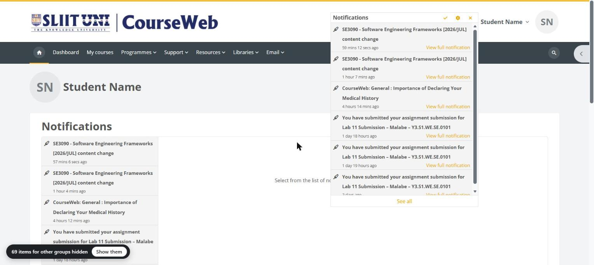
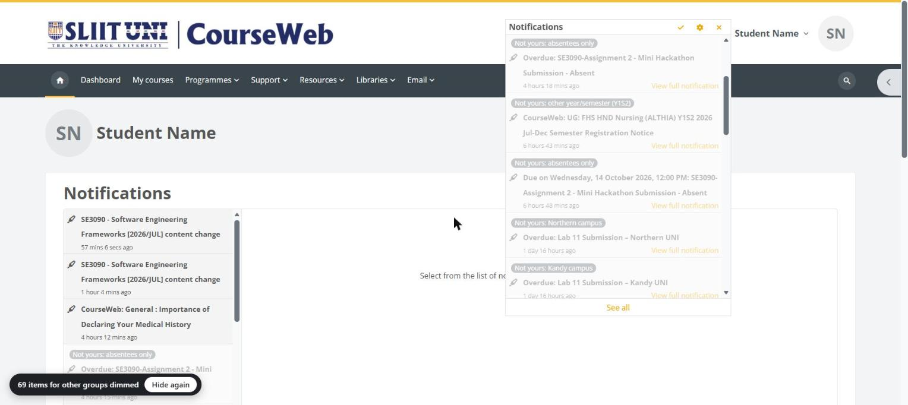
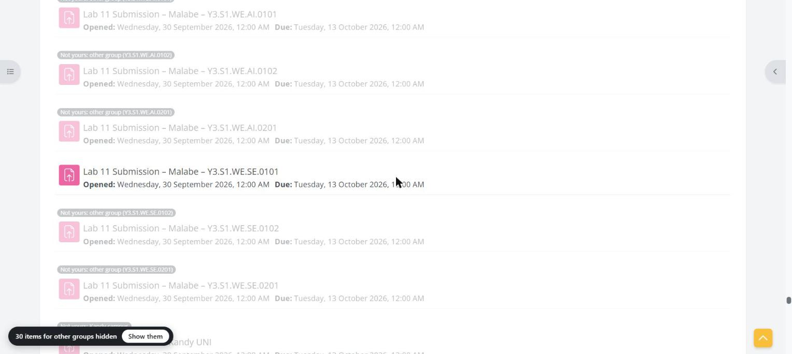
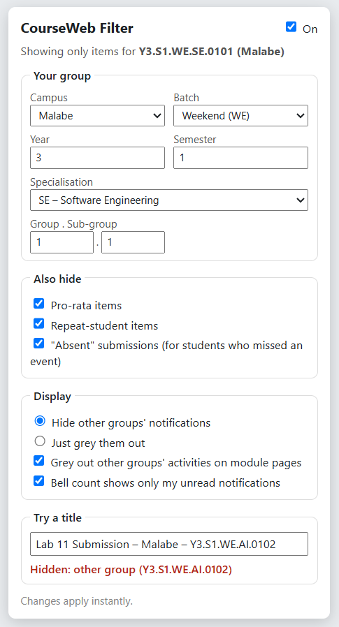

# CourseWeb Notifications Filter (SLIIT)

SLIIT's CourseWeb sends every student the notifications for **every** group: other sub-groups, other
specialisations, the weekday batch, Kandy and Northern campus, pro-rata students… Your own deadlines get buried.

This project shows you **only what's meant for your group**:

* a **browser extension** that cleans up the CourseWeb website, and
* a set of **Outlook rules** that clean up the CourseWeb emails.

> Unofficial student project. Not affiliated with SLIIT. It only changes what *you* see. It never submits, edits,
> deletes or marks anything as read on CourseWeb.

---

## What it looks like

### The bell dropdown: only your notifications
Out of the latest 20 notifications, only the 6 that are actually yours are left. The bell number counts only
*your* unread notifications (18 → 4 in testing).



### "Show them": see what was hidden, and why
Click **Show them** in the bottom-left pill to bring hidden items back, greyed out, each with a
**"Not yours: …"** tag giving the reason (other group, other campus, absentees only, other year…). Click
**Hide again** to tidy up.



### Module pages: your submission link stands out
On module pages, other groups' activities are **greyed out, never hidden**, so you can still open anything.
Here only `Lab 11 Submission – Malabe – Y3.S1.WE.SE.0101` stays bright.



### Settings
Click the extension icon to set your group. **Try a title** shows instantly whether any title would be shown or
hidden, and why.



---

## Install the extension (about 1 minute)

Works in Chrome, Edge, Brave and other Chromium browsers.

1. Download this repo: **Code → Download ZIP**, then unzip it (or `git clone` it).
2. Open the extensions page: `chrome://extensions` (Chrome) or `edge://extensions` (Edge).
3. Turn on **Developer mode** (a switch, top-right in Chrome or on the left in Edge).
4. Click **Load unpacked** and select the **`extension`** folder inside this project.
5. Click the puzzle-piece icon and **pin** CourseWeb Filter.
6. Click its icon, **set your group**, then refresh CourseWeb.

Setting your group, using `Y3.S1.WE.SE.0101` as an example:

| Field | Example | Where it comes from |
| --- | --- | --- |
| Campus | Malabe | your campus |
| Batch | Weekend (WE) | `WE` = weekend, `WD` = weekday |
| Year / Semester | 3 / 1 | `Y3.S1` |
| Specialisation | SE – Software Engineering | pick from the dropdown (see below) |
| Group . Sub-group | 1 . 1 | `0101` = group 01, sub-group 01 |

The specialisation dropdown lists every code found in real CourseWeb group codes:

| Code | Specialisation |
| --- | --- |
| `IT` | Information Technology (also used for Year 1–2 groups before specialising) |
| `SE` | Software Engineering |
| `AI` | Artificial Intelligence |
| `DS` | Data Science |
| `CS` | Cyber Security |
| `CSNE` | Computer Systems & Network Engineering |
| `ISE` | Information Systems Engineering |
| `IM` | Interactive Media |

If SLIIT adds a new one, choose **Other…** and type the code exactly as it appears in your group code
(e.g. `CYS` for `Y3.S1.WE.CYS.0101`).

Each new semester, just update Year / Semester / Group.

**Updating:** after pulling a new version, press the **reload** icon on the extension's card in the extensions
page.

---

## How it decides what's yours

**No AI, just pattern matching**, and it all runs inside your browser. It reads only the **title** of each
notification, timeline entry or activity, and runs it through these checks in order. The first one that matches
decides:

| # | Check | Example title | Result |
| - | --- | --- | --- |
| 1 | **Group code** in the title? It decides alone. | `…Malabe – Y3.S1.WE.SE.0101` | ✅ yours |
| | Your whole group counts too | `WEEKLY QUIZ 11 - Y3.S1.WE.IT.03, Y3.S1.WE.SE.01` | ✅ yours |
| | Any other group | `…Y3.S1.WE.SE.0102`, `…WE.AI.0101`, `…WD.SE.0101` | ❌ hidden |
| 2 | Pro-rata / repeat / absent | `WEEKLY QUIZ 6 - Y3.S1 Prorata Students` | ❌ hidden |
| 3 | Other batch (weekday vs weekend) | `Presentation Schedule - Weekday`, `Lab 3 (Monday - WD)` | ❌ hidden |
| 4 | Other campus (unless your campus is also named) | `Lab 11 Submission – Kandy UNI`, `NorthernUni - …` | ❌ hidden |
| 5 | Other year / semester | `FOC Y1S1 Module Registrations` | ❌ hidden |
| 6 | Other faculty / postgraduate | `FHS HND Nursing …`, `PG: Master of Education …` | ❌ hidden |
| 7 | Nothing above matched | `Assignment 1 - Submission`, `Lab Sheet 5 - Malabe` | ✅ kept (common to everyone) |

**When in doubt, it keeps the item.** Items without a title, like the long text areas on module pages, are never
touched, because free text such as a lecturer contact list could mention "Kandy" and fool the rules.

Each of the pro-rata / repeat / absent rules can be switched off in the settings.

**Privacy:** the extension has no server and sends nothing anywhere. The only network request it makes is to
CourseWeb itself, to read your own notification list (so long titles in the bell dropdown aren't cut off).

---

## Cleaning up the emails (Outlook)

CourseWeb emails come from `coursewebalerts@sliit.lk` and land in your **Outlook / Microsoft 365** mailbox
(`<student-id>@my.sliit.lk` at [outlook.office.com](https://outlook.office.com)), **not** in the Gmail of the same
address. If they seem to "disappear" when you check Gmail, that's why.

Outlook rules run on Microsoft's servers, so they keep working when your computer is off. Outlook can only check
"subject contains some text", so the logic is split into **7 rules in a fixed order**. Each one has
**"Stop processing more rules"** ticked:

| # | Name | Subject includes (any of) | Except if subject includes | Action |
| - | --- | --- | --- | --- |
| 1 | CW1 mine - my sub-group | `Y3.S1.WE.SE.0101` `WE.SE.1.01` | | Categorize "CourseWeb - mine" |
| 2 | CW2 other sub-groups of my group | `Y3.S1.WE.SE.010` `Y3.S1.WE.SE.011` | | Move to "CourseWeb - not mine", mark as read |
| 3 | CW3 mine - my whole group | `Y3.S1.WE.SE.01` | | Categorize "CourseWeb - mine" |
| 4 | CW4 other groups | `Y1.S` `Y2.S` `Y3.S` `Y4.S` `.WE.` `.WD.` `WE.SE.` `WD.` | | Move + mark as read |
| 5 | CW5 other campuses | `Kandy` `Northern` `Matara` `Kurunegala` `Jaffna` | `Malabe` | Move + mark as read |
| 6 | CW6 weekday batch | `Weekday` `Week day` `- WD)` `(WD)` | `Weekend` | Move + mark as read |
| 7 | CW7 pro-rata, repeat, absent, other faculties/years | `Prorata` `Pro rata` `Pro-rata` `Repeat` `Absent` `FHS` `Nursing` `PG:` `PG :` `Postgraduate` `Master of` `Y1S1` `Y1S2` `Y2S1` `Y2S2` `Y3S2` `Y4S1` `Y4S2` `Year 1 Semester` `Year 2 Semester` `Year 4 Semester` `Year 3 Semester 2` | | Move + mark as read |

Every rule also has the condition **From = `coursewebalerts@sliit.lk`**.

**Why this order?** Outlook matches plain text, so `Y3.S1.WE.SE.01` would also match `…SE.0102`. Rule 1 keeps
your sub-group first, rule 2 moves the other sub-groups of your group, rule 3 keeps whole-group items, and rule 4
then moves any group code that's left.

**For a different group:** change `Y3.S1.WE.SE` / `0101` / `Malabe` in `scripts/outlook-rules.js`, run
`npm test` to confirm it still matches the extension, then `npm run rules` to print your personal list.

**To add them:** in Outlook on the web, go to **Settings (⚙) → Mail → Rules → Add new rule**.

Tested on 322 real CourseWeb emails: **225 would be moved, 97 kept**. Nothing is deleted. Moved emails go to a
"CourseWeb - not mine" folder you can check any time.

---

## For developers

```
npm test        # 73 checks against real CourseWeb titles + Outlook-rules consistency check
npm run rules   # print the Outlook rules
```

```
extension/
  filter.js        the "is this mine?" logic (shared with tests and the popup)
  content.js/.css  runs on courseweb.sliit.lk: hides/dims items, fixes the bell count
  popup.*          settings popup
  manifest.json
tests/
  fixtures.js      real CourseWeb titles with the expected answer
  filter.test.js
scripts/
  outlook-rules.js the Outlook rules as data + a checker that compares them with filter.js
docs/
  screenshots/     README images (names replaced with "Student Name")
  popup-preview.html  opens the popup outside the extension, for screenshots
```

If a CourseWeb title is classified wrongly, add it to `tests/fixtures.js` with the right answer, fix `filter.js`
until `npm test` passes, and open a pull request.
